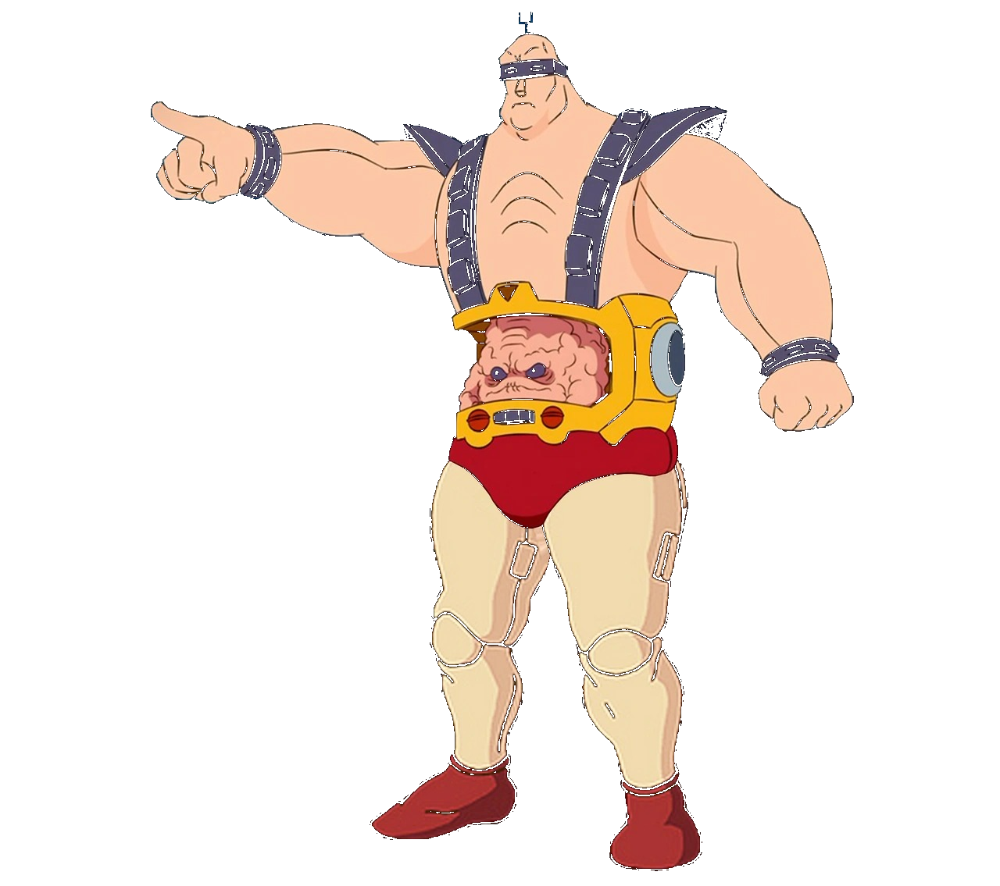

<div align="center">



# Ship Harness Bench

**A benchmark to evaluate the quality of different LLM coding harnesses**

</div>

---

## The Prompt

Each agent received the **same prompt** and produced a browser-based 3D ship simulator:

> Create a beautiful, relaxing, 3D ship simulator for the browser with the sun in the horizon alternating day and night and when you click on the sea the water makes a wave

## The Model

Most tests were done with **Deepseek V4 Flash 0731**.

### Model sizes (total B)

<div>
<div><b>GLM-5.3 — 744B total · 40B active</b><br/><div style="background:#e5e7eb;border-radius:999px;height:14px;width:100%;max-width:500px;"><div style="background:#3b82f6;border-radius:999px;height:14px;width:100%;"></div></div><sub>MoE · ~753B checkpoint</sub></div>
<br/>
<div><b>MiMo v2.5 — 310B total · 15B active</b><br/><div style="background:#e5e7eb;border-radius:999px;height:14px;width:100%;max-width:500px;"><div style="background:#3b82f6;border-radius:999px;height:14px;width:41.7%;"></div></div><sub>MoE</sub></div>
<br/>
<div><b>DeepSeek V4 Flash 0731 — 284B total · 13B active</b><br/><div style="background:#e5e7eb;border-radius:999px;height:14px;width:100%;max-width:500px;"><div style="background:#3b82f6;border-radius:999px;height:14px;width:38.2%;"></div></div><sub>MoE · 304B with DSpark module</sub></div>
<br/>
<div><b>Hy4 flash — 220B total · 12B active</b><br/><div style="background:#e5e7eb;border-radius:999px;height:14px;width:100%;max-width:500px;"><div style="background:#3b82f6;border-radius:999px;height:14px;width:29.6%;"></div></div><sub>MoE · incl. 64B Engram · 1M context</sub></div>
<br/>
<div><b>Qwen3.6-35B-A3B — 35B total · 3B active</b><br/><div style="background:#e5e7eb;border-radius:999px;height:14px;width:100%;max-width:500px;"><div style="background:#3b82f6;border-radius:999px;height:14px;width:4.7%;min-width:8px;"></div></div><sub>MoE</sub></div>
<br/>
<div><b>Qwen3.8-27B — 27B total · dense</b><br/><div style="background:#e5e7eb;border-radius:999px;height:14px;width:100%;max-width:500px;"><div style="background:#3b82f6;border-radius:999px;height:14px;width:3.6%;min-width:8px;"></div></div><sub>dense</sub></div>
<br/>
<div><b>Muse Spark 1.3 — undisclosed</b><br/><sub>proprietary, closed · size not published</sub></div>
</div>

| Model | Size in B (total) | Active in B | Type |
|-------|-------------------|-------------|------|
| GLM-5.3 | 744 | 40 | MoE |
| MiMo v2.5 | 310 | 15 | MoE |
| DeepSeek V4 Flash 0731 | 284 (304 with DSpark) | 13 | MoE |
| Hy4 flash | 220 (incl. 64B Engram) | 12 | MoE |
| Qwen3.6-35B-A3B | 35 | 3 | MoE |
| Qwen3.8-27B | 27 | 27 | dense |
| Muse Spark 1.3 | undisclosed | undisclosed | proprietary, closed |

## The Agents

| Agent | Simulator | Approach |
|-------|-----------|----------|
| [Codex](./ship-sim-codex/) | Ship Sim | Import maps + modular Three.js |
| [DSH](./ship-sim-dsh/) | Open Sea | Self-contained inline bundle |
| [Jcode](./ship-sim-jcode/) | Voyager | Vanilla JS + verification scripts |
| [Jcode FX](./ship-sim-jcode-fx/) | Ship Simulator | Bun-built bundle |
| [Jcode 2](./ship-sim-jcode2/) | Sunset Sails | Static vanilla JS |
| [O-0x](./ship-sim-o-0x/) | Adrift | Vendored Three.js |
| [Muse](./ship-sim-o-muse-1.2/) | Drift | Vite build + custom fonts |
| [OpenCode](./ship-sim-opencode/) | Sunset Sail | Vendored Three.js |
| [Pi](./ship-sim-pi/) | A Quiet Sea | TypeScript + Vite + seagulls/audio |
| [Hy4 flash — OpenCode](./ship-hy4-flash-opencode/) | Serenity | Import maps + CDN Three.js, shader ocean + click ripples |
| [Q3.8 27B — Pi (gsq)](./ship-q3.8-27b-pi-gsq/) | Adrift | Vendored Three.js, shader swell + click ripples |

## Takeaways

- **The model is important, but the harness is a worthy optimization.** The same model can produce vastly different results depending on the tooling around it.
- **A good browser-use tool is one of the most useful skills.** Being able to see, interact with, and verify what the model produces in a real browser is a game changer.
- **Memory and other tools could also be useful.** Context retention and auxiliary capabilities shape the quality of the output as much as the model itself.

## Running Locally

```bash
# Serve the gallery
python3 -m http.server 2222
# Open http://localhost:2222
```
